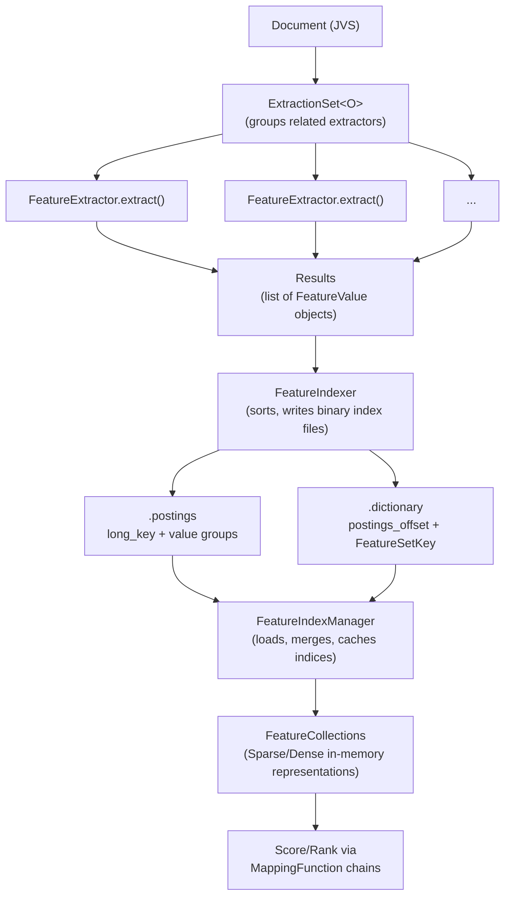

# hitorro-features

Feature extraction, indexing, and processing engine for ML pipelines and search ranking.

## Overview

The hitorro-features module provides a file-based feature extraction and indexing system. It supports extracting features from documents, storing them in efficient binary index files (no database required), and retrieving them for scoring, ranking, and ML applications.

### Key Capabilities

- **Feature Extraction Pipeline** - Configurable extractors process documents and produce typed feature values
- **File-Based Indexing** - Binary `.postings` + `.dictionary` file format for efficient feature storage and retrieval
- **7 Data Types** - byte, short, int, long, float, double, string with type-safe I/O
- **Sparse and Dense Collections** - Choose between hash-map-based sparse or packed-array dense in-memory representations
- **Multi-Tenancy** - `RealmId` scoping for partitioning features by tenant/realm
- **Derived Features** - Compute features from other features via mapping function chains
- **Pluggable Extractors** - Extend `FeatureExtractor<O>` to add custom extraction logic
- **Mapping Functions** - Transform feature values with chainable score mapping functions

## Architecture



### Package Structure

```
com.hitorro.features/
├── Feature                    # Base feature definition (name, dataType, cardinality, keyType)
├── DerivedFeature             # Feature computed from another via mapping functions
├── FeatureValue               # Extracted value wrapper (extends FeatureSetKey)
├── FeatureSetKey              # Unique feature set identifier (hash, partition, realm, index/variable)
├── FeatureEngine              # Singleton coordinator for all features
├── FeatureService             # Service initialization from JVS properties
├── FVComparator               # Deterministic ordering (SetComp, IDComp modes)
├── RealmId                    # Two-part tenant scope (realm + id)
│
├── DataType                   # Enum: byte, short, int, long, float, double, string
├── FeatureCardinality         # Enum: single, named, index
├─�� FeatureKeyType             # Enum: document, company, eid
├── FeatureType                # Enum: base, derived, function
├── PartitionModel             # Enum: None, Date, Hash
│
├── extractor/
│   ├── FeatureExtractor<O>    # Abstract base for all extractors
│   ├── ExtractorDefinition    # Defines an extractor (class, description, properties)
│   ├── ExtractorManager       # Manages extractor definitions and creates extraction sets
│   ├── ExtractionSet<O>       # Collection of extractors for a feature group
│   ├── ExtractionContext       # Per-thread extraction state with two-level cache
│   ├── Results                # Container for extracted FeatureValue objects
│   └── ResetableContext       # Self-instantiating resettable state interface
│
├── index/
│   ├── FeatureIndexer         # Writes features to binary index files
│   ├── FeatureIndexManager    # Manages multiple indices (load, merge, cache)
│   ├── FeatureIndexFileReader # Reads a single index file (dictionary + postings)
│   ├── FeatureIndexReader     # Base reader for iterating features
│   ├── PostingsFeatureReader  # Reads postings file via FSInputStream
│   ├── SelectTreeReader       # Merges multiple readers (tree-based)
│   ├── FeatureQueryContext     # Query state management
│   └── FeatureCacheManager    # Cache reload integration
│
├── collections/
│   ├── BaseCollection<S>      # Abstract base (score, type-specific getters, clone)
│   ├── CollectionType         # Enum: Sparse, Dense, Cascade, Function
│   ├── Sparse: SparseByteFC, SparseShortFC, SparseIntFC, SparseLongFC,
│   │          SparseFloatFC, SparseDoubleFC, SparseStringFC
│   ├── Dense:  DenseByteFC, DenseShortFC, DenseIntFC, DenseLongFC,
│   │          DenseFloatFC, DenseDoubleFC, DenseStringFC
│   ├── CascadingCollection    # Combines multiple collections
│   └── mapping/
│       ├── MappingFunction<I,O>  # Type-safe mapper interface (chainable)
│       ├── ScoreFunctionBase     # Common mapper logic with defaults
│       ├── ScoreMappingFunction  # Score transformation interfaces (per type)
│       ├── noop/                 # Pass-through implementations per type
│       └── LuceneSimilarityByteScoreMappingFunction
│
├── io/
│   ├── BaseIO<T,E>           # Generic read/write interface
│   ├── ByteIO, ShortIO, IntegerIO, LongIO, FloatIO, DoubleIO, StringIO
│   ├── key/
│   │   ├── Key               # Abstract key type
│   │   ├── IntKey, LongKey   # Concrete key implementations
│   └── FloatLogNorm, IntLogNorm  # Log normalization
│
└── pipeline/
    ├── FeatureDatePartitioner # Date-based partitioning from FeatureValue.time
    └── SimilarityCompressor   # Similarity score compression
```

## Type System

### DataType

| Type | Width | Null Value | Class |
|------|-------|-----------|-------|
| `byteType` | 1 byte | `Byte.MIN_VALUE` | `Byte` |
| `shortType` | 2 bytes | `Short.MIN_VALUE` | `Short` |
| `integerType` | 4 bytes | `Integer.MIN_VALUE` | `Integer` |
| `longType` | 8 bytes | `Long.MIN_VALUE` | `Long` |
| `floatType` | 4 bytes | `Float.MIN_VALUE` | `Float` |
| `doubleType` | 8 bytes | `Double.MIN_VALUE` | `Double` |
| `stringType` | variable | `null` | `String` |

Each DataType provides factory methods for I/O (`getCopyOfIO()`), sparse collections (`getCopyOfSparseCollection()`), dense collections (`getCopyOfSDenseCollection()`), and string mappers (`getFromStringMapper()`).

### FeatureCardinality

- **`single`** - One value per feature per document
- **`named`** - Multi-valued with string-keyed entries
- **`index`** - Multi-valued with integer-indexed entries

### FeatureKeyType

- **`document`** - One key per document
- **`company`** - Group-based keys
- **`eid`** - Ephemeral IDs

### PartitionModel

- **`None`** - No partitioning
- **`Date`** - Time-based partitioning
- **`Hash`** - Hash-based partitioning

## Dependencies

| Dependency | Version | Purpose |
|-----------|---------|---------|
| hitorro-core | 3.0.1 | Foundation utilities, serialization, file I/O |
| hitorro-jsontypesystem | 3.0.1 | JVS documents and type definitions |
| trove4j | 3.0.3 | Efficient primitive collections (TLongObjectHashMap, etc.) |
| slf4j-api | 2.0.9 | Logging interface |
| logback-classic | 1.4.11 | Logging implementation |

### Maven Coordinates

```xml
<dependency>
    <groupId>com.hitorro</groupId>
    <artifactId>hitorro-features</artifactId>
    <version>3.0.1</version>
</dependency>
```

## Building

```bash
# Build the module (from the hitorro root)
mvn clean install -pl hitorro-features

# Build without tests
mvn clean install -pl hitorro-features -DskipTests

# Build with all transitive dependencies
mvn clean install -pl hitorro-features -am

# Build fat JAR (jar-with-dependencies)
mvn clean package -pl hitorro-features

# Deploy to local Maven repo
./build-and-deploy.sh --clean
```

## Testing

```bash
# Run all tests
mvn test -pl hitorro-features

# Run a specific test class
mvn test -pl hitorro-features -Dtest=DataTypeTest

# Run a specific test method
mvn test -pl hitorro-features -Dtest=DataTypeTest#testDataTypeNames
```

### Test Coverage

| Test Class | Coverage |
|-----------|----------|
| `DataTypeTest` | All 7 data types: names, widths, class types, null values, I/O, collections, string mappers |
| `FeatureTypeTest` | Feature type enumeration |
| `FeatureCardinalityTest` | Cardinality enumeration |
| `FeatureKeyTypeTest` | Key type enumeration |
| `PartitionModelTest` | Partition model enumeration |
| `RealmIdTest` | Construction, getters/setters, toString, fromString, hashing, equality, serialization metadata |
| `ScoreFunctionBaseTest` | Initialization, default values, null handling |
| `NoOpByteScoreMappingFunctionTest` | Byte pass-through scoring |
| `NoOpIntegerScoreMappingFunctionTest` | Integer pass-through scoring |
| `NoOpFloatScoreMappingFunctionTest` | Float pass-through scoring |
| `NoOpStringScoreMappingFunctionTest` | String pass-through scoring |
| `ResultsTest` | Result container add/clear/getAllValues operations |

## Key Concepts

### FeatureEngine

Singleton coordinator that manages all feature definitions and their hash-based lookups. Initialized from JVS configuration.

### Extraction Pipeline

1. `ExtractionSet<O>` groups related `FeatureExtractor<O>` instances
2. Each extractor's `extract(object, results, context)` method produces `FeatureValue` objects
3. `ExtractionContext` provides per-thread state with two cache levels (per-extraction and lifetime)
4. `Results` collects all extracted values, queryable by constraint via `HTPredicate<FeatureValue>`

### Index File Format

Features are stored in a two-file binary format:
- **`.postings`** - Sorted `<long_key><value>` entries grouped by FeatureSetKey, groups terminated by `Long.MIN_VALUE`
- **`.dictionary`** - `<postings_offset><FeatureSetKey>` entries for seeking into postings

`FeatureIndexManager` handles loading, merging, and caching multiple index files.

### FVComparator Ordering

Deterministic ordering for feature values before indexing:
1. Partition
2. Realm ID
3. Feature hash
4. Index
5. Variable (if named cardinality)
6. ID (only in `IDComp` mode)

Two static instances: `FVComparator.SetComp` (groups by feature set) and `FVComparator.IDComp` (includes document ID).

## Design Patterns

- **Factory** - `DataType` factories for I/O, collections; `FeatureType.getFeatureInstance()`; `ExtractorDefinition.getInstance()`
- **Singleton** - `FeatureEngine` with `getEngine()`/`setEngine()`
- **Strategy** - `FeatureExtractor` subclasses; `MappingFunction` implementations
- **Chain of Responsibility** - Mapping function chains in `DerivedFeature`
- **Template Method** - `BaseCollection.score()` with type-specific implementations
- **Context Object** - `ExtractionContext` for shared extraction state
- **Iterator** - `FeatureReader`, `SelectTreeReader` for index traversal
- **Comparator** - `FVComparator` with Set and ID comparison modes

## License

MIT License - Copyright (c) 2006-2025 Chris Collins
